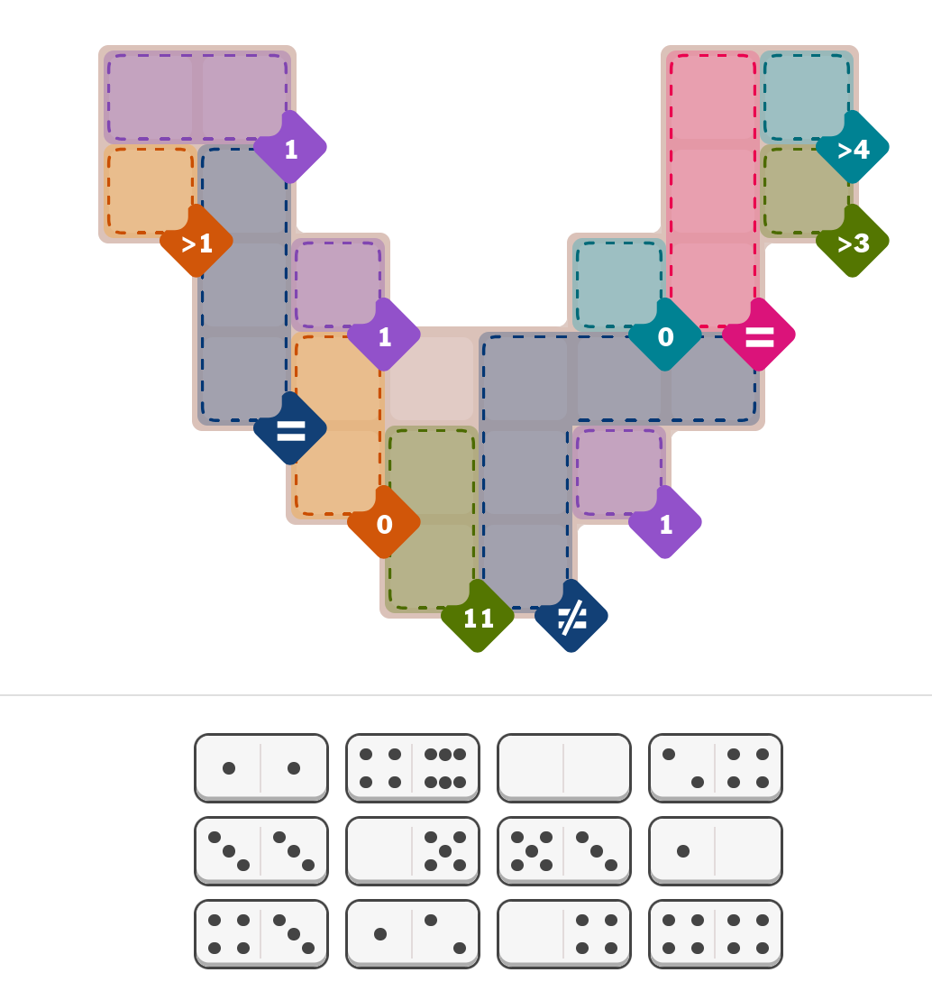

# Pips Puzzle Solver

This project is a solver for pips puzzles, like the ones found in the New York Times.

## Installation

This project uses `uv` for dependency management. To install the required development dependencies, run the following command:

```bash
uv add --dev pytest pytest-cov
```

## Usage

You can solve a puzzle by providing a TOML or CSV file containing the puzzle's data.

### From a TOML file:

```bash
uv run solve_pips.py -t <path_to_your_puzzle>.toml
```

### From a CSV file:

```bash
uv run solve_pips.py -c <path_to_your_puzzle>.csv
```

### Verbose Mode

To see more detailed logging output, you can use the `-v` or `--verbose` flag:

```bash
uv run solve_pips.py -t <path_to_your_puzzle>.toml -v
```

## Puzzle File Formats

### TOML

The TOML file should define the board's layout, the constraints, and the dominoes to be used.

The board are specified using the `layout` array. Each element in the array represents a row of the board and specify the constraints for that row.

The constraints are specified using the following operators:

- `+N`: The dominoes within these cells have a sum total of `N`.
- `==`: These dominoes have equal values.
- `!=`: All of these dominoes have different values.
- `>N`: The sum total of these dominoes are greater than N
- `<N`: The sum total of these dominoes are less than N
- `x` : The cell cannot be occupied.
- `.` : You can place any number into this cell.

The dominoes are specified as an array of strings, where each string represents a domino tile. In pips, all the dominoes are different, i.e. no repetition of dominoes is allowed.

For example, for the following puzze:



The toml file should be:

```bash
[board]
layout=[
    "AAxxxxBC",
    "DExxxxBF",
    "xEGxxHBx",
    "xEI.JJJx",
    "xxIKJLxx",
    "xxxKJxxx"]
[constraints]
A="+1"
B="=="
C=">4"
D=">1"
E="=="
F=">3"
G="+1"
H="+0"
I="+0"
J="!="
K="+11"
L="+1"
[dominoes]
tiles=[
    "11",
    "46",
    "00",
    "24",
    "33",
    "05",
    "53",
    "10",
    "43",
    "12",
    "04",
    "44"
]
```

### CSV

The CSV file is a faster way to specify the puzzle, it contains the dominoes on the first line, followed by the board layout with constraints. For example, for the above puzzle, the csv file should be

**Example:**

```bash
11,46,00,24,33,05,53,10,43,12,04,44
A+1,A+1,  x,   x,  x,  x,B==,C>4
D>1,E==,  x,   x,  x,  x,B==,F>3
  x,E==,G+1,   x,  x,H+0,B==,  x
  x,E==,I+0,   .,J!=,J!=,J!=,  x
  x,  x,I+0,K+11,J!=,L+1,  x,  x
  x,  x,  x,K+11,J!=,  x,  x,  x
```

And the output of the program will be:

````bash
dominoes={Domino(0 | 0), Domino(1 | 0), Domino(3 | 3), Domino(4 | 3), Domino(5 | 3), Domino(0 | 5), Domino(0 | 4), Domino(2 | 4), Domino(1 | 1), Domino(1 | 2), Domino(4 | 4), Domino(4 | 6)}
Board =
| 1| 1| X| X| X| X| =|>4|
|>1| =| X| X| X| X| =|>3|
| X| =| 1| X| X| 0| =| X|
| X| =| 0| .| .| .| .| X|
| X| X| 0|11| .| 1| X| X|
| X| X| X|11| .| X| X| X|

Answer =
| 1| 0|  |  |  |  | 3| 5|
| 2| 4|  |  |  |  | 3| 4|
|  | 4| 1|  |  | 0| 3|  |
|  | 4| 0| 4| 2| 0| 3|  |
|  |  | 0| 5| 1| 1|  |  |
|  |  |  | 6| 4|  |  |  |
```

````
